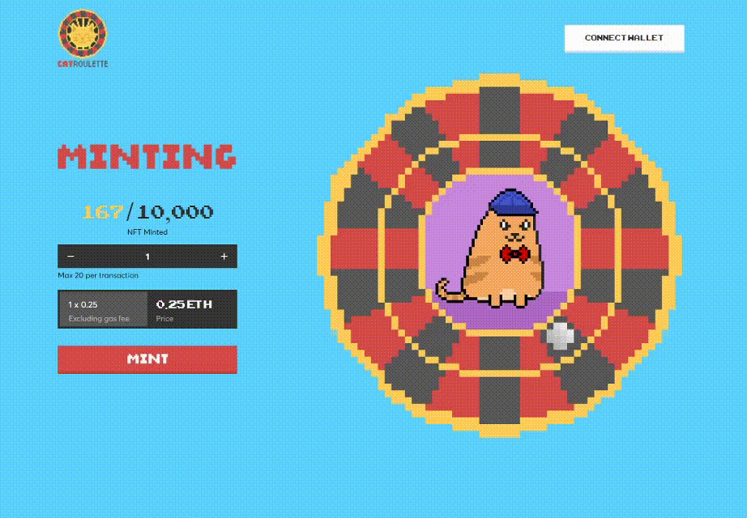

# Volodymyr Korzhov

### Senior Frontend Engineer | React · React Native · TypeScript

New York, NY · [LinkedIn](https://www.linkedin.com/in/volodymyr-korzhov-8254181a2/) · [Email](mailto:korgov.vova@icloud.com) · [Upwork](https://www.upwork.com/freelancers/~01b72f8dc40d4284b2)

Software engineer with **6+ years of experience** building and maintaining web and mobile applications. I specialize in React, React Native, JavaScript, and TypeScript, with a focus on usable interfaces, reliable application behavior, and maintainable architecture.

I lead frontend development on **reacHIRE’s Aurora platform**, working across UI delivery, state management, API integrations, navigation, and legacy modernization. I collaborate closely with product, design, and backend engineers to deliver features across web, iOS, and Android.

I also build end-to-end products with AI coding agents, expanding into Node.js services, integrations, and data-backed applications. My strongest area is frontend engineering; I direct, integrate, test, and iterate on AI-generated backend functionality.

 

## Technical skills

| Area | Technologies and practices |
| --- | --- |
| Frontend & mobile | React, React Native, TypeScript, JavaScript (ES6+), HTML, CSS, Redux, MobX |
| UI & interaction | Responsive UI, accessibility, Figma, GSAP, Framer Motion |
| Application engineering | REST APIs, authentication flows, client-side architecture, routing/navigation, debugging, refactoring, third-party SDK integration, Git |
| Backend & tooling exposure | Node.js, Express/Fastify, Ruby on Rails, MongoDB, WebSockets, AWS, Heroku |
| Development workflow | AI-assisted full-stack development and coding agents, validation, debugging, iterative delivery |

## Experience

### Lead Frontend Developer · reacHIRE
**March 2022 – Present · New York, NY · Remote**

[Aurora](https://aurora.reachire.com/) is a web and React Native platform supporting collaboration and engagement across organizations.

- Develop and maintain features across web and mobile, translating product and design requirements into reliable interfaces.
- Own React/JavaScript work involving API integrations, MobX/Redux state management, MVVM-style patterns, navigation, and refactoring.
- Work on React Native upgrades, native integrations, authentication/token storage, push-notification interactions, and chat functionality across iOS and Android.
- Collaborate on API contracts and Ruby on Rails-backed pages, investigating issues across UI and integration behavior.
- Use AI-assisted coding and analysis to accelerate implementation and debugging while validating outcomes.

### Web3 / Frontend Developer · ETNA Network
**April 2021 – November 2021 · Remote**

- Built responsive interfaces for a decentralized application, integrating web3.js and external APIs.
- Converted product designs into accessible web pages and translated stakeholder requirements into implementation.

### Frontend Developer · Etorg
**February 2020 – February 2021 · Odesa, Ukraine**

- Delivered responsive websites and interactive JavaScript interfaces from Figma designs for agency clients.

## Independent engineering projects

### Trading market screener & alerting tools

- Built a market-monitoring application using Bybit REST/WebSocket integrations, JavaScript/Node.js services, MongoDB, and cloud hosting.
- Developed data-processing and notification workflows around open interest and trading volume, iterating on API integration, runtime behavior, and operational reliability.

### AI-assisted full-stack product development · Ongoing

- Use AI coding tools to plan, implement, integrate, and test backend endpoints, services, and supporting infrastructure.
- Direct requirements and development iterations, validate end-to-end behavior, and investigate errors while expanding my backend architectural and operational understanding.

## Portfolio

### Aurora · Web & mobile platform

[Visit Aurora](https://aurora.reachire.com/)

Earlier frontend and Web3 demos

### OneSeed · Web3 dApp

### Cat Roulette · Frontend

[View demo](https://thirsty-noyce-eebf1a.netlify.app)

### Sensei Shib · Frontend

[View demo](https://lucid-heisenberg-50986a.netlify.app)

### Quokka · Frontend

[View demo](https://upbeat-wing-9fc17f.netlify.app/)

## Education

- **Master’s degree, Law** · National University “Odesa Law Academy” · 2020
- **Frontend / React training** · IT School Hillel · 2019–2021
